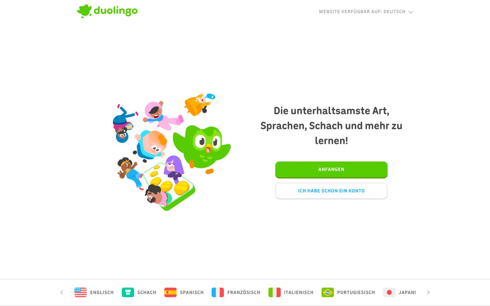



<section class="simple" data-transition="none">
  

    <h1>Unscharf und grau</h1>
    

      <figure style="flex:3; margin:0;"></figure>
      

        
<strong>1.</strong> Illustration

        
<strong>2.</strong> Button »Anfangen«

        
<strong>3.</strong> Headline

        
      

    

  

</section>
