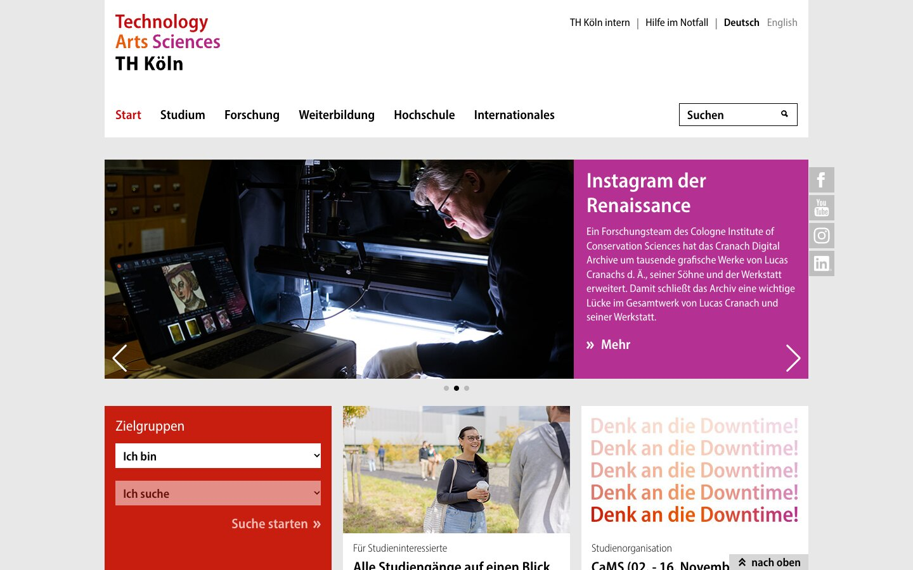



<section class="image screenshot shadow" data-transition="fade" data-background-transition="fade"><figure><figcaption class="bu">
Screen A: Was sehen Sie zuerst, als Zweites, als Drittes?
</figcaption></figure></section>

<section class="image screenshot shadow" data-transition="fade" data-background-transition="fade"><figure><figcaption class="bu">
Screen B: Was sehen Sie zuerst, als Zweites, als Drittes?
</figcaption></figure></section>

<section class="image screenshot shadow" data-transition="fade" data-background-transition="fade"><figure><figcaption class="bu">
Screen C: Was sehen Sie zuerst, als Zweites, als Drittes?
</figcaption></figure></section>










