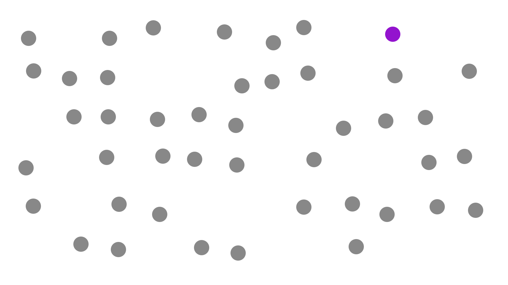
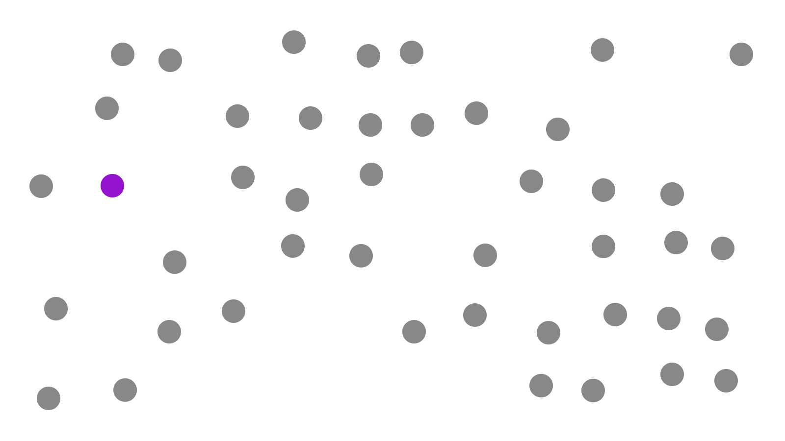
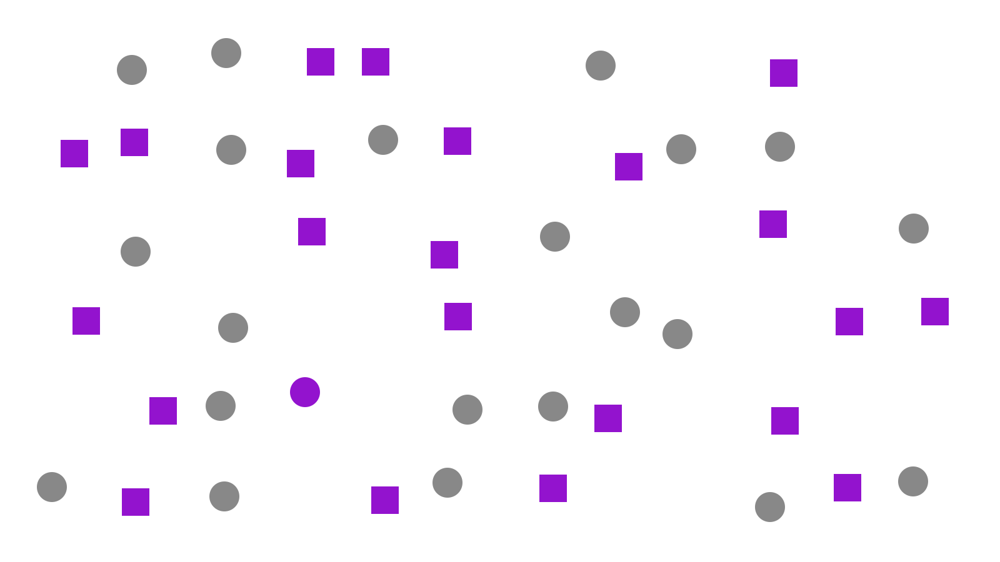
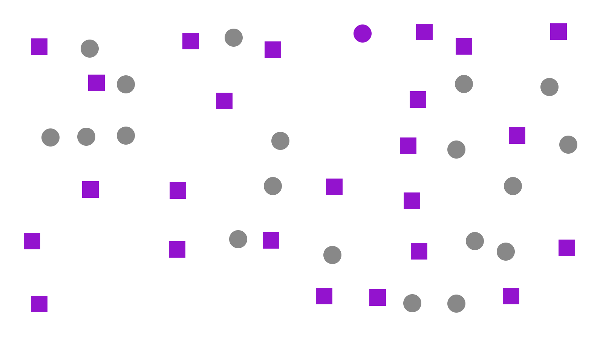



<section class="simple" data-transition="none">
  

    <h1>Durchgang 1</h1>
    
Links oder rechts? Zeigen Sie sofort in die Richtung.

    

  

</section>

<section class="simple" data-transition="none">
  

    <h1>Durchgang 2</h1>
    
Links oder rechts? Zeigen Sie sofort in die Richtung.

    

  

</section>



<section class="simple" data-transition="none">
  

    <h1>Durchgang 3</h1>
    
Links oder rechts? Zeigen Sie sofort in die Richtung.

    

  

</section>

<section class="simple" data-transition="none">
  

    <h1>Durchgang 4</h1>
    
Links oder rechts? Zeigen Sie sofort in die Richtung.

    

  

</section>



